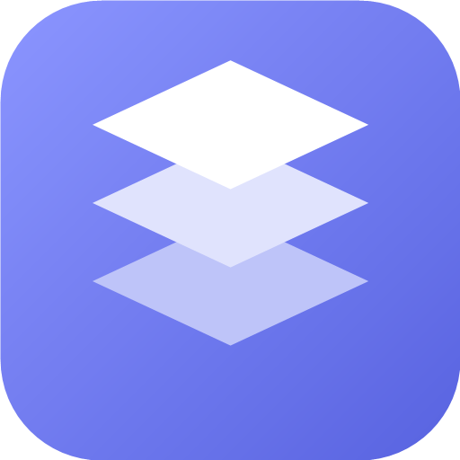

  

<h1 align="center">StackTok</h1>

  Менеджер аккаунтов TikTok в стиле Liquid Glass. 
  Сколько угодно аккаунтов, у каждого свой вход — переключение в один клик.

---

## Что внутри

**Инструменты**
Страница «Инструменты» собирает все возможности приложения в одном месте и раскладывает их по разделам («Анализ», «Чистка аккаунта», «Чаты», «Файлы»). Вверху выбирается аккаунт, с которым работают инструменты. Если действие сейчас недоступно (нет входа, нет ключа API), на карточке написано почему. Новые возможности появляются там же.

**Психопортрет по репостам**
**Быстрый способ:** откройте в «Обзоре» профиль нужного человека (страница вида tiktok.com/@имя) и нажмите «Запустить анализ @имя» в панели управления над страницей. Кнопка активна только на странице профиля и сразу начинает работу (500 последних репостов, без кадров из видео), спрашивая только, куда сохранить файл. Другой способ: Инструменты → «Психопортрет по репостам» с выбором числа репостов и кадров. Нужен ключ API в «Настройках». Можно выбрать **любой публичный профиль**: впишите @имя или ссылку, входить в TikTok для этого не нужно (достаточно любого аккаунта в списке, из его окна идут запросы), либо свой аккаунт. У закрытых профилей репосты не видны, тогда работа останавливается с сообщением. Приложение собирает репосты профиля (на выбор до 200, 500, 1000 или 1500 последних), скачивает обложки, нейросеть читает текст на них и подписи, а затем пишет подробный портрет: образ, черты характера, настроение, о чём человек, похоже, думает, чувства и отношения (какие сигналы есть в ленте: влюблённость, тоска, расставание и как они менялись), мотивы, интересы, юмор, манера общения, вкус, ценности, «улики» с обложками, как менялась лента, сильные и слепые стороны. Результат сохраняется одной HTML-презентацией в выбранное место (листается стрелками, открывается без интернета). По желанию можно добавить кадры из видео: это глубже, но медленнее и дороже, и берутся первые 48 видео. Портрет строится в фоне, прогресс виден в углу окна. Это догадки по ленте, а не факты: репост показывает вкусы, а не человека целиком. Чего портрет не делает (так написано в запросе к модели): не ставит клинических диагнозов, не делает категоричных выводов о расе, национальности и ориентации и не называет третьих лиц. Текст запроса лежит в файле `psycho-prompt.ts` и правится как обычный текст.
Ключ API вводится в «Настройках». Подойдёт ключ Claude, OpenAI, Gemini, OpenRouter, DeepSeek, локальной модели или сервиса-перепродавца с форматом OpenAI (тогда выберите «Свой адрес» и впишите адрес и названия моделей). По умолчанию выбрана самая дешёвая модель с поддержкой картинок (Claude Haiku 5.5). Модель должна уметь читать картинки, иначе разбор пойдёт только по подписям. Стоимость зависит от числа репостов; её показывает ваш провайдер.

**Изолированные аккаунты**
У каждого аккаунта свой профиль браузера: свои cookies, хранилище и кэш. Входы не пересекаются и сохраняются между запусками.

**Переключение за секунду**
Выбирайте аккаунт в боковой панели или клавишами `Ctrl+1…9`. `Ctrl+N` — добавить новый.

**Обычный TikTok**
Каждый аккаунт сразу открывается на странице «Публикации» TikTok Studio. Остальной сайт (лента, поиск, профили) тоже работает прямо в приложении. Если встроенный просмотр что-то блокирует, страницу можно открыть в браузере по умолчанию.

**Подтверждение аккаунта**
После входа приложение показывает, чей это профиль, и просит подтвердить — чтобы сессия не оказалась привязана не к тому аккаунту.

**Где открывать аккаунт**
На карточке аккаунта выбирается стартовая страница: TikTok Studio (по умолчанию), ваш профиль или чаты. Кнопка «Открыть» и кнопка «Домой» ведут туда.
Иногда TikTok не отдаёт страницу профиля или чатов (ошибка 403, белый экран). Тогда приложение открывает Studio и показывает сообщение; повторить можно кнопкой «Домой» чуть позже.

**Чаты, профиль и Studio в один клик**
Кнопка «Чаты» в «Обзоре» и на карточке аккаунта открывает сообщения TikTok именно этого аккаунта. Панель управления «Обзора» разбита на группы: навигация (назад, вперёд, обновить, домой), страницы («Студия», «Профиль», «Чаты»), действия («Экспорт чата», «Удалить репосты») и кнопка «Запустить анализ» для открытого профиля, справа звук, «Открыть в браузере» и диагностика. В узком окне у кнопок остаются только значки, подсказка всплывает при наведении.

**Экспорт чата**
Откройте диалог на странице «Чаты» и нажмите «Экспорт чата» в «Обзоре». Приложение заберёт всю переписку у TikTok теми же запросами, которыми страница сама подгружает старые сообщения, только много штук одновременно, сверит результат с тем, что видно на странице, и сохранит HTML-страницу в выбранное место. Если напрямую не получилось, оно промотает переписку до самого начала, как раньше: это медленнее, и в файле будет пометка. В файле: кто и что написал, время и даты, ссылки, стикеры и картинки (внутри файла, они не пропадут, когда ссылки TikTok устареют), присланные видео и пересланные комментарии с обложкой, подписью и ссылкой, служебные сообщения TikTok. Всё, что приложение не распознало, лежит в «Подробности» в исходном виде. Крупные файлы (больше 1,5 МБ) лежат в папке «имя_файла_files» рядом со страницей: храните их вместе. Есть поиск, фильтры по автору и типу, переход к дате, светлая и тёмная тема и кнопка «Скачать JSON».
Экспорт идёт в фоне: можно переключаться между страницами и аккаунтами, закрыть окно другими окнами или свернуть его, прогресс виден вверху, отменить можно кнопкой. Скорость зависит от ответов TikTok: на проверках большие чаты выгружались со скоростью в сотни сообщений в секунду (2 000 сообщений за несколько секунд, 19 000 примерно за полторы минуты). Если TikTok начнёт ограничивать запросы или попросит проверку, экспорт остановится с сообщением: подождите несколько минут и повторите. Если приложение не уверено в полноте (список показывает сообщения окном, TikTok не отдал всю историю), в файле будет предупреждение, а не молчаливая потеря.

**Удаление всех репостов**
Кнопка «Репосты» на карточке аккаунта (или «Удалить репосты» в панели «Обзора», или карточка на странице «Инструменты») убирает все его репосты, любой давности, после подтверждения. Приложение находит репосты через список TikTok (проходит даже пустые страницы, которые TikTok отдаёт на месте недоступных видео), снимает их по несколько штук одновременно, а потом ищет заново с самого начала и повторяет, пока не останется ни одного. Удаление засчитывается, только если TikTok его подтвердил. Если TikTok просит притормозить, приложение делает паузу и продолжает; если пауз не хватает, просит проверку или капчу, оно останавливается с сообщением, и запуск позже продолжит с оставшихся. Прогресс виден в углу окна, остановить можно в любой момент. Собственные видео, лайки и подписки не затрагиваются. Репосты видео, которые TikTok больше не показывает (удалённые или скрытые автором), в его списке не появляются, их приложение увидеть не может.

**Оформление чатов**
Стеклянный вид для сообщений TikTok: обои (градиент или своя картинка PNG, JPG, WebP до 2 МБ), затемнение обоев, размер текста и режим приватности: имена, превью и сообщения размыты, пока не наведёте мышь, удобно при записи экрана. Оформление включается и выключается в настройках, логику сайта оно не меняет и сообщения не читает.

**Загрузчик**
Вкладка «Загрузчик» открывает сайт tikdownloader.io прямо в приложении. Он работает в отдельной временной сессии: ваши входы в TikTok на сайт не передаются, а cookies загрузчика не сохраняются после закрытия приложения. Сайт сторонний, на нём может быть реклама.

**Настройки под себя**
Светлая, тёмная или системная тема, десять акцентных цветов и любой свой из палитры, двенадцать фонов (включая «Свой» из трёх цветов), прозрачное стекло с выбором материала окна (акрил или слюда), ползунок матовости стекла и выключатель движения света. Кнопки окна нарисованы самим приложением.

## Безопасность

- Пароли нигде не хранятся.
- Cookies остаются внутри приложения и не попадают в интерфейс.
- Страницам tiktok.com разрешены обычные функции сайта (копирование ссылки, уведомления и т. п.). Остальным сайтам, включая загрузчик, разрешения не выдаются.
- Сайт TikTok изолирован от интерфейса приложения.
- Загрузчик: сторонний сайт в изолированной вьюхе без доступа к аккаунтам, без разрешений на камеру, микрофон и т. п., всплывающие окна запрещены.
- Экспорт чата запускается только вашей кнопкой. Он ничего не отправляет и не нажимает, но обращается к TikTok теми же запросами, какими пользуется сама страница чата, от имени выбранного аккаунта; данные входа остаются внутри приложения. Файл создаётся локально там, где вы укажете, и никуда не передаётся. В нём лежит ваша переписка, храните его приватно.
- Удаление репостов запускается только вашей кнопкой и подтверждением. Запросы идут со страницы TikTok выбранного аккаунта, с его входом; перед стартом приложение проверяет, что вход принадлежит подтверждённому аккаунту. Ничего, кроме снятия репостов, не делается, и нигде не сохраняется.
- Психопортрет запускается только вашей кнопкой. Обложки, подписи и теги репостов отправляются выбранному вами провайдеру нейросети: доверяйте ему так же, как любому сервису, который видит ваши данные. Ключ API хранится зашифрованным средствами Windows в отдельном файле и не показывается в интерфейсе. В презентацию попадают подписи и маленькие обложки; храните файл приватно, особенно если он про чужой аккаунт.
- Оформление чатов только добавляет стили; скрипты на страницу TikTok не внедряются. Картинка для обоев читается и проверяется внутри приложения и в интерфейс не передаётся.
- Убрать аккаунт из списка можно, не стирая его вход; данные сессии удаляются отдельным действием.

## Где хранятся данные

Экспортированные чаты приложение нигде не хранит: файл и папка с крупными вложениями лежат только там, куда вы их сохранили.

`%APPDATA%\stacktok`: список аккаунтов с настройками, файл `chat-wallpaper.txt` с вашей картинкой для обоев (если выбрана), файл `psy-key.bin` с зашифрованным ключом API (если сохранён) и папка `Partitions` с профилями. В профилях лежат входы, поэтому копию папки храните приватно.
