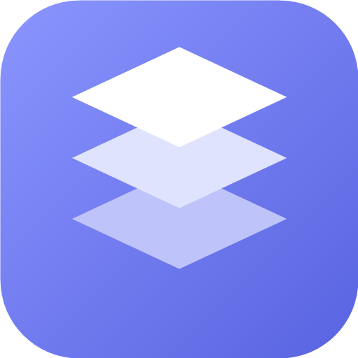

  

<h1 align="center">StackTok</h1>

  Менеджер аккаунтов TikTok в стиле Liquid Glass. 
  Сколько угодно аккаунтов, у каждого свой вход — переключение в один клик.

---

## Что внутри

**Изолированные аккаунты**
У каждого аккаунта свой профиль браузера: свои cookies, хранилище и кэш. Входы не пересекаются и сохраняются между запусками.

**Переключение за секунду**
Выбирайте аккаунт в боковой панели или клавишами `Ctrl+1…9`. `Ctrl+N` — добавить новый.

**Обычный TikTok**
Каждый аккаунт сразу открывается на странице загрузки TikTok Studio. Остальной сайт (лента, поиск, профили) тоже работает прямо в приложении. Если встроенный просмотр что-то блокирует, страницу можно открыть в браузере по умолчанию.

**Подтверждение аккаунта**
После входа приложение показывает, чей это профиль, и просит подтвердить — чтобы сессия не оказалась привязана не к тому аккаунту.

**Настройки под себя**
Светлая, тёмная или системная тема, пять акцентных цветов, пять фонов, включая прозрачное стекло и ползунок матовости стекла.

## Безопасность

- Пароли нигде не хранятся.
- Cookies остаются внутри приложения и не попадают в интерфейс.
- Сайт TikTok изолирован от интерфейса приложения.
- Убрать аккаунт из списка можно, не стирая его вход; данные сессии удаляются отдельным действием.

## Где хранятся данные

`%APPDATA%\stacktok`: список аккаунтов с настройками и папка `Partitions` с профилями. В профилях лежат входы, поэтому копию папки храните приватно.
